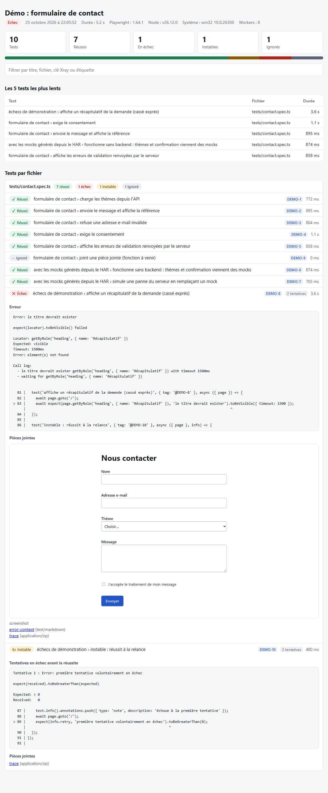

# playwright-report-kit

[](https://github.com/samsteeven/playwright-report-kit/actions/workflows/ci.yml)

Un reporter pour [Playwright](https://playwright.dev) qui, à la fin d'un run, fait quatre choses avec les mêmes résultats :

1. écrit **un rapport HTML autonome** (un seul fichier, clair et sombre, filtres, captures intégrées) ;
2. exporte un **JUnit XML** que l'import d'**Xray** comprend (clé de test, exigences, étiquettes, commentaire d'exécution) et l'y envoie ;
3. poste une **carte Teams** (via un flux **Power Automate**) quand un test échoue ;
4. génère des **mocks d'API lisibles à partir d'un fichier HAR** (un fichier JSON par route, secrets masqués) et les branche dans un test.



Le dépôt contient une **démo** (un formulaire de contact et 10 tests) qui exerce les quatre volets. Il a aussi été branché sur la suite E2E d'un vrai projet, **TribuneJustice** (voir [Chiffres](#chiffres)).

## Ce qui est vérifié, et ce qui ne l'est pas

| Volet | Vérifié | Pas vérifié |
|---|---|---|
| Rapport HTML | tests unitaires (dont l'échappement des balises injectées), run réel sur la démo et sur TribuneJustice, captures clair/sombre | rendu dans d'autres navigateurs que Chromium |
| JUnit | XML analysé par un vrai parseur dans les tests ; propriétés prévues par la [documentation Xray](https://docs.getxray.app/display/XRAYCLOUD/Taking+advantage+of+JUnit+XML+reports) | **import dans un vrai Xray** |
| Envoi à Xray | authentification + import contre un **faux serveur** du dépôt (`tools/mock-xray.mjs`) qui imite les deux appels de l'API REST v2 ; réessais, refus d'identifiants, XML refusé | **un vrai Xray** : je n'ai pas fait d'essai gratuit. Le faux serveur compte les cas de test reçus, il ne crée ni ne lie aucun ticket Jira |
| Teams | forme de la carte (carte adaptative dans une enveloppe `message`), taille, notification selon le mode ; réception par un récepteur local (`tools/teams-sink.mjs`) | **un vrai flux Power Automate** : je n'ai pas vérifié l'affichage dans Teams |
| Mocks HAR | tests unitaires, HAR enregistré avec un vrai Chromium, mocks rejoués dans des tests de la démo | HAR de gros sites réels (WebSocket, GraphQL par lots, flux) |

Les deux « faux » serveurs sont dans `tools/` pour que n'importe qui puisse reproduire les résultats. **Ils ne remplacent pas un essai sur un vrai Xray et un vrai Teams** : les étapes pour le faire sont plus bas.

## Installation

```bash
npm install --save-dev playwright-report-kit
```

Pré-version `0.1.0` : voir « Ce qui est vérifié » plus haut avant de s'y fier pour Xray et Teams. Pour suivre la branche `main` (le paquet se compile à l'installation) : `npm install --save-dev github:samsteeven/playwright-report-kit`.

Node 20 ou plus. Playwright : testé avec la **1.64.1** seulement (les étiquettes `tag:` demandent la 1.42 ou plus).

```ts
// playwright.config.ts
import { defineConfig } from '@playwright/test';

export default defineConfig({
  reporter: [
    ['list'],
    ['playwright-report-kit', { title: 'Mes parcours', outputDir: 'report-kit' }],
  ],
});
```

Le reporter écrit dans `outputDir` (relatif au dossier de la configuration) :

| Fichier | Contenu |
|---|---|
| `report.html` | le rapport, autonome |
| `junit.xml` | l'export pour Xray |
| `summary.json` | les chiffres du run, lisibles par une machine |
| `xray-result.json` | la réponse d'Xray (si l'envoi est configuré) |

Un échec d'Xray ou de Teams n'est **jamais** fatal : un avertissement s'affiche, les fichiers locaux restent, le code de sortie de Playwright n'est pas modifié.

### Options et variables d'environnement

Tout se règle par option ou par variable ; les secrets passent par l'environnement, jamais par le code.

| Option | Variable | Rôle |
|---|---|---|
| `title` | `PRK_TITLE` | titre du rapport |
| `outputDir` | `PRK_OUTPUT_DIR` | dossier de sortie (défaut `report-kit`) |
| `html`, `junit` | | `false` pour désactiver ; `junit: { xray: false }` pour un JUnit standard |
| `xray` | `XRAY_PROJECT_KEY`, `XRAY_CLIENT_ID`, `XRAY_CLIENT_SECRET` | active l'envoi à Xray |
| | `XRAY_BASE_URL` | défaut `https://xray.cloud.getxray.app` |
| | `XRAY_TEST_EXEC_KEY`, `XRAY_TEST_PLAN_KEY` | compléter une exécution ou un plan existants |
| `teams` | `TEAMS_WEBHOOK_URL` | active la notification |
| | `PRK_NOTIFY` | `failure` (défaut), `always` ou `never` |
| | `PRK_REPORT_URL` | ajoute un bouton « Ouvrir le rapport » (lien vers l'artefact de CI) |

Le reporter se branche aussi sans toucher à la configuration : `npx playwright test --reporter=list,node_modules/playwright-report-kit/dist/index.js` et les variables ci-dessus.

## Xray

Les clés se déclarent dans le test : par étiquette, par annotation, ou dans le titre.

```ts
test('connexion réussie', { tag: '@TJ-12', annotation: { type: 'requirement', description: 'TJ-1, TJ-2' } }, async ({ page }) => { /* … */ });
// ou : test.info().annotations.push({ type: 'xray', description: 'TJ-12' });
```

Pour chaque test, le JUnit contient les propriétés que l'import d'Xray documente : `test_key`, `test_summary`, `requirements`, `tags`, `testrun_comment` (message d'échec, ou « instable : réussi après N relance(s) »), plus `started-at` et `finished-at`. Sans `test_key`, Xray retrouve ou crée un test « générique » à partir de `classname` + `name` : le kit rend ces noms **uniques** (préfixe du projet Playwright si plusieurs, puis `(#2)`) pour que deux tests ne soient pas fusionnés. Le `classname` est le chemin du fichier depuis le dossier de la configuration.

Correspondance des statuts d'après la documentation d'Xray : échec → FAIL, ignoré → TODO, le reste → PASS. **Un test instable (réussi à la relance) est envoyé comme réussi**, avec un commentaire.

Envoyer un fichier déjà produit : `XRAY_PROJECT_KEY=… npx prk xray-upload report-kit/junit.xml`.

**Pour vérifier sur un vrai Xray** (ce que je n'ai pas fait) : créer une clé d'API Xray (client id et secret), définir `XRAY_*` avec la clé du projet Jira, lancer un run court, puis contrôler dans Jira que la Test Execution contient les bons tests et statuts, et que les `test_key` pointent bien vers des tests existants.

## Teams, via Power Automate

Le reporter poste, sur l'adresse d'un flux, une carte adaptative dans l'enveloppe `{ "type": "message", "attachments": [ … ] }`, le format que Microsoft documente pour les flux déclenchés par « Quand une requête de webhook Teams est reçue ». La carte indique le titre, les compteurs, la durée et les premiers échecs ; elle est réduite automatiquement pour rester sous une limite de taille de 24 Ko.

Pour la brancher : dans Power Automate, créer un flux à partir du modèle « Publier dans un canal quand une requête de webhook est reçue », choisir l'équipe et le canal, copier l'adresse HTTP générée dans le secret `TEAMS_WEBHOOK_URL` de la CI. Cette adresse donne le droit de poster : **ne pas la commiter**.

## Mocks d'API depuis un fichier HAR

1. Enregistrer un parcours : `recordHar` de Playwright (voir `demo/scripts/record-har.mjs`).
2. Générer :

```bash
npx prk har-mocks demo/recordings/contact.har --out demo/mocks
# 2 route(s) écrites dans demo/mocks
#   GET    /api/topics  ->  200  (1 appel(s) enregistré(s))
#   POST   /api/contact  ->  201  (2 appel(s) enregistré(s))
#   1 valeur(s) masquée(s) ([REDACTED])
```

3. Les utiliser dans un test :

```ts
import { applyMocks } from 'playwright-report-kit';

const { hits } = await applyMocks(page, 'demo/mocks');
// pour un cas d'erreur : remplacer un mock sans toucher aux fichiers
await applyMocks(page, 'demo/mocks', { overrides: { POST_api_contact: { status: 500, body: { error: 'down' } } } });
```

Chaque route donne un fichier JSON **que l'on peut relire et corriger à la main** (`POST_api_contact.json` : méthode, chemin généralisé `/api/cases/:id`, statut, type, corps, origine de l'enregistrement, remarques). Ce que le générateur fait :

- **généralise les chemins** : identifiants numériques, UUID et hexadécimaux longs deviennent `:id` ; `/api/cases/stats` l'emporte sur `/api/cases/:id` ;
- **fusionne les appels** d'une même route et garde le dernier (`--pick first` pour le premier) ; il note les statuts différents vus (422 puis 201) ;
- **écarte** les pages, scripts, images et polices (`--all` pour les garder), `--include` / `--exclude` filtrent par expression ;
- **retire** les en-têtes sensibles (`Set-Cookie`, `Authorization`…) et **masque** dans les corps JSON les valeurs des clés `token`, `password`, `secret`, `authorization`, `api key`, `cookie`, `session`, `jwt` (`--redact-keys` pour changer la liste, `--no-redact` pour désactiver).

**Le HAR brut contient tout** (cookies, jetons, données de personnes) : ne le commitez pas, ou nettoyez-le d'abord. Le masquage ne regarde que le **nom des clés** JSON : un e-mail ou un nom dans un champ `message` n'est pas masqué.

Playwright sait déjà rejouer un HAR (`page.routeFromHAR`). Ce que ce kit ajoute, c'est un **format éditable** (un fichier par route, plutôt qu'un bloc opaque), la **généralisation des chemins**, le **masquage des secrets** et le **remplacement d'une réponse** pour un test d'erreur. Ce qu'il fait moins bien : un seul corps par route (`routeFromHAR` sait suivre l'ordre des appels) et la **requête** n'est pas examinée (ni l'URL complète, ni le corps envoyé).

## Démo

```bash
npm ci && npm run build
npx playwright install chromium
npm run demo:test                 # 10 tests, dont 3 ignorés ; le rapport est dans demo/report-kit/
DEMO_FAIL=1 npm run demo:test     # ajoute un échec et un test instable, pour voir comment le rapport les montre
```

Avec les serveurs simulés (dans deux autres terminaux : `npm run demo:xray` et `npm run demo:sink`) :

```bash
XRAY_BASE_URL=http://127.0.0.1:4400 XRAY_CLIENT_ID=demo-id XRAY_CLIENT_SECRET=demo-secret XRAY_PROJECT_KEY=DEMO \
TEAMS_WEBHOOK_URL=http://127.0.0.1:4500/webhook DEMO_FAIL=1 npm run demo:test
```

La CI du dépôt exécute la démo (vrai Chromium) avec le faux Xray et garde le rapport en artefact.

## Chiffres

Mesurés le 2026-10-25 sur un portable Windows 11 (8 workers pour la démo, 1 worker pour TribuneJustice), Node 24, Playwright 1.64.1, Chromium.

| | Tests | Durée du run | Résultat |
|---|---|---|---|
| Démo du dépôt | 10 (3 ignorés) | **2,4 s** (4,7 s démarrage du serveur compris) | 7 réussis |
| Démo avec `DEMO_FAIL=1` | 10 | 5,2 s | 7 réussis, 1 échec, 1 instable, 1 ignoré |
| **TribuneJustice** (suite E2E d'un projet réel, front Angular SSR, API simulée) | **98 dans 16 fichiers** | **2 min 35 s** (154,7 s) | 97 réussis, 1 échec |

**Remontée dans Xray : 98 tests envoyés au *faux* serveur du dépôt** (un JUnit de 47 Ko, 98 `testcase`), **0 vers un vrai Xray**. Aucun des 98 tests de TribuneJustice ne porte encore de clé Xray (`@TJ-…`) : ils seraient donc créés comme tests génériques à partir de leur nom. C'est à corriger dans les tests avant un vrai import.

Ce que ces chiffres ne disent pas :

- **Coût du reporter** : la même suite sans le reporter a pris 152 s (mur, une mesure) contre 157 s avec lui, démarrage des serveurs simulés compris. Une seule mesure de chaque : c'est dans le bruit, pas une preuve que le coût est nul ni de 5 s.
- Le test en échec de TribuneJustice **échoue dans la suite complète (deux runs sur deux) mais passe seul (deux fois sur deux)** : il attend une requête 10 s et dépasse le délai dans la suite. Le rapport l'affiche avec l'erreur et la capture ; je n'ai pas cherché la cause.
- Le rapport de TribuneJustice n'est pas publié ici (noms de tests et extraits de code d'un dépôt privé) ; seuls les chiffres le sont.


## Limites

- **Pas de test sur un vrai Xray ni un vrai Teams** (voir le tableau en haut).
- **Un shard, un rapport** : avec `--shard`, chaque processus écrit son propre rapport ; il n'y a pas de fusion.
- Le rapport ne montre que les **pièces jointes de la dernière tentative** ; les erreurs des tentatives précédentes d'un test instable sont conservées.
- Les mocks HAR ignorent la chaîne de requête et le corps envoyé : deux appels de la même route avec des paramètres différents partagent la même réponse.
- Les fichiers `trace` et `video` sont des liens relatifs au rapport : le rapport doit rester à côté d'eux (ou être publié avec).
- Testé avec Playwright 1.64.1, sous Windows et sur le runner Linux de GitHub, Node 24.

## Développement

```bash
npm ci
npm test            # compile puis lance 51 tests (Vitest), dont un run réel de Playwright sur un petit projet
npm run typecheck
```

Structure : `src/` (reporter, `junit.ts`, `html.ts`, `xray.ts`, `teams.ts`, `har/`), `tools/` (faux Xray, récepteur Teams, captures du README), `demo/` (application, tests, HAR et mocks), `test/`.

## Licence

MIT.
